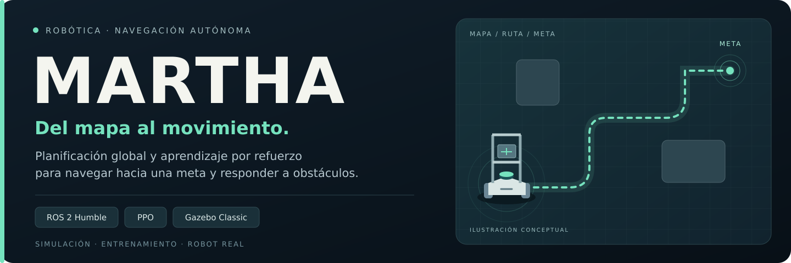
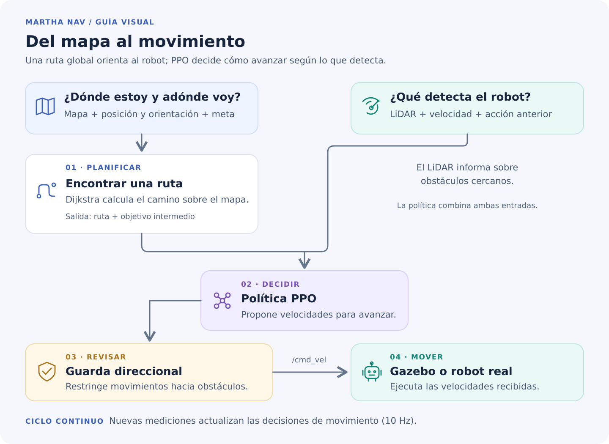
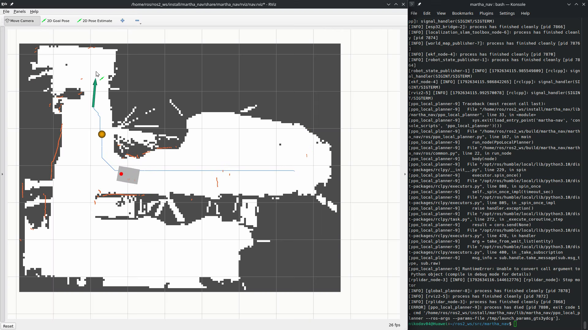

<p align="center">
  
</p>

<p align="center">
  <a href="docs/manual-usuario.md"><strong>Manual de usuario</strong></a> ·
  <a href="#cómo-funciona">Cómo funciona</a> ·
  <a href="#resultados-y-limitaciones">Resultados</a> ·
  <a href="#evidencias-del-robot-real">Evidencias</a> ·
  <a href="docs/comandos.md">Referencia de comandos</a>
</p>

# Martha Nav

**Del mapa al movimiento: un robot que sigue una ruta y responde a los obstáculos.**

Sistema de navegación para **Martha** y **TurtleBot3 Burger** que combina planificación
sobre un mapa con una política **PPO** de aprendizaje por refuerzo. El planificador
global calcula la ruta y la política local usa el LiDAR para decidir las velocidades.

Desarrollado como parte del trabajo de tesis sobre el planificador local de Martha.
Incluye simulador 2D, integración con ROS 2 y Gazebo Classic, políticas entrenadas y
componentes de despliegue en robots reales.

| Entrenar | Simular | Desplegar |
|:---|:---|:---|
| Simulador 2D y PPO con escenarios variados. | Gazebo, RViz y evaluación por episodios. | Inferencia con NumPy, SLAM e interfaces de hardware. |

## Empieza aquí

| Quiero… | Dónde empezar |
|---|---|
| Instalar y probar el proyecto | [Requisitos e instalación](docs/manual-usuario.md#requisitos-e-instalación) |
| Ver el robot navegar | [Manual de simulación](docs/manual-usuario.md#manual-de-simulación) |
| Entrenar una política | [Entrenamiento y evaluación](docs/manual-usuario.md#entrenamiento-y-evaluación) |
| Utilizar Martha o Burger reales | [Uso en robots reales](docs/manual-usuario.md#uso-en-robots-reales) |
| Resolver un problema | [Pruebas y solución de problemas](docs/manual-usuario.md#pruebas-y-solución-de-problemas) |

### Primera demostración

Con ROS 2 Humble y el workspace **ya instalados y cargados**, desde la raíz del
repositorio:

```bash
ros2 launch martha_nav sim.launch.py \
  world:=lab drive:=planar rviz:=true \
  checkpoint:="$(pwd)/policies/martha.npz"
```

En RViz, selecciona **2D Goal Pose** sobre una zona libre para enviar una meta.
La modalidad `planar` permite probar navegación sin simular la dinámica de ruedas.
Para instalación desde cero, cancelación de metas y otras opciones, sigue el
[manual paso a paso](docs/manual-usuario.md#manual-de-simulación).

## Cómo funciona



[Ver el diagrama en formato vectorial](docs/como-funciona.svg).

El LiDAR se reduce a **90 sectores** y sus distancias se codifican como `d/(d+1)`.
La observación reúne esos sectores, distancia y ángulo al objetivo intermedio,
velocidad medida y acción anterior: 96 valores con dos acciones o 98 con tres.
El nodo local calcula comandos a **10 Hz** y detiene el movimiento si faltan datos
recientes de los sensores.

Hay tres perfiles en [`martha_nav/robots.py`](martha_nav/robots.py):

| Perfil | Plataforma | Particularidad |
|---|---|---|
| `martha` | Base con ruedas mecanum | Permite acciones `(v, w)` o `(vx, vy, w)`, según el modelo entrenado. |
| `martha_tower` | Martha con torre de aluminio | Modela los postes que atraviesan el plano del LiDAR. Requiere una política compatible con ese perfil. |
| `burger` | TurtleBot3 Burger diferencial | Perfil configurado para LiDAR LDS-01 de 3,5 m y acciones `(v, w)`. |

Se incluyen dos políticas listas para inferencia:

| Archivo | Entrenamiento de origen | Acciones |
|---|---|---|
| [`policies/martha.npz`](policies/martha.npz) | `wide_dyn_s0` | Avance/retroceso y giro; **no ordena movimiento lateral**. |
| [`policies/burger.npz`](policies/burger.npz) | `burger_s1` | Avance/retroceso y giro. |

Los `.npz` ejecutan la inferencia con NumPy, sin PyTorch. Los checkpoints `.zip`
necesitan las dependencias de aprendizaje y su `config.yaml` asociado. No se incluye
una política para `martha_tower`. El cargador comprueba la compatibilidad del perfil;
no basta con cambiar el nombre del robot para reutilizar una política.

## Trabajo realizado

| Componente | Desarrollo incluido |
|---|---|
| Simulador 2D | Entorno de aprendizaje con cinemática, LiDAR, colisiones, mapas rasterizados desde archivos `.world`, escenarios paramétricos y obstáculos que no aparecen en el mapa global. |
| Planificación global | Rutas mediante Dijkstra sobre una rejilla de ocupación inflada, seguimiento del avance y selección de un punto objetivo intermedio (*carrot* o zanahoria). |
| Aprendizaje | PPO con extractor CNN para el LiDAR, registro de recompensas, evaluación periódica y selección del mejor modelo; variantes con movimiento lateral, memoria LSTM y recompensa geodésica. |
| Transferencia a Gazebo | Modelos de robot, mundos, sensores, control mecanum o movimiento planar, transformaciones TF y evaluación por episodios. |
| Navegación ROS 2 | Nodos de mapa, planificación global, inferencia de la política, publicación de velocidades, cancelación de metas y guarda direccional ante obstáculos. |
| Localización | Integración con `slam_toolbox` para mapear y localizarse; en simulación también se puede utilizar la pose verdadera de Gazebo. |
| Martha real | Firmware ESP32, control de motores, encoders, giroscopio, puente serial, RPLIDAR y fusión de odometría mediante EKF. |
| TurtleBot3 Burger | Perfil propio de cuerpo y LiDAR, simulación, exportación de políticas a NumPy y herramientas de despliegue en Raspberry Pi. |
| Análisis experimental | Comparación de configuraciones, transferencia 2D–Gazebo, trayectorias, éxito, colisiones, estancamientos, SPL y bitácoras de resultados. |
| Verificación | Pruebas del simulador, recompensas, políticas, geometría, nodos, launch, URDF e interfaces de hardware. |

La existencia de los componentes de hardware no equivale a una validación experimental
completa del robot real. El alcance de los resultados se detalla más adelante.

## Organización del repositorio

```text
martha_nav/
├── martha_nav/
│   ├── sim2d/       # Simulador, observaciones, recompensa y planificación
│   ├── learning/    # Entrenamiento, evaluación y exportación
│   ├── ros/         # Nodos e integración ROS 2
│   └── robots.py    # Perfiles de robot
├── launch/          # sim.launch.py, real.launch.py y burger.launch.py
├── policies/        # Políticas NumPy incluidas
├── config/          # Controladores, EKF, LiDAR y puntos de evaluación
├── urdf/            # Modelos de Martha y Burger
├── worlds/          # Escenarios de Gazebo
├── rviz/            # Configuración de visualización
├── firmware/        # Programa de la ESP32 y control de hardware
├── tools/           # Evaluación, mapas, gráficas y despliegue
├── test/            # Pruebas automatizadas
└── docs/            # Diseño, comandos y resultados
```

`runs/`, `maps/` y `entrega_tesis/` son salidas locales excluidas de Git. Un clon
nuevo no contiene los checkpoints históricos, mapas guardados ni todos los CSV
mencionados en las bitácoras. `docs/entrega/` describe el paquete de evidencias,
pero no contiene ese paquete completo.

## Resultados y limitaciones

La [bitácora de resultados](docs/resultados.md) registra el estudio de codificación
LiDAR, recompensa, estabilidad de PPO, CNN frente a MLP, acciones holonómicas,
memoria recurrente, variación de dinámica, localización y soporte Burger.

Como referencia, estos valores son **resultados históricos documentados**, no
mediciones obtenidas al preparar este README:

| Modelo y condición | Episodios | Éxito |
|---|---:|---:|
| Martha `wide_dyn_s0`, 2D `lab` con obstáculos | 200 | 85,5 % |
| Martha `wide_dyn_s0`, Gazebo `lab`, evaluación `v5` | 100 | 87,0 % |
| Martha `wide_dyn_s0`, Gazebo puntos fijos de `lab`, `v5` | 90 | 91,1 % |
| Burger `burger_s1`, 2D `lab`, inflado 0,40 m | 200 | 88,0 % |
| Burger `burger_s1`, Gazebo `lab`, inflado 0,40 m | 100 | 82,0 % |
| Burger `burger_s1`, Gazebo puntos fijos de `lab`, inflado 0,40 m | 90 | 83,3 % |

Consultar las condiciones y comparaciones en las secciones de reevaluación `v5`
y Burger del 2026-10-07 de la bitácora. Las tablas de 200 episodios 2D y 100 de
Gazebo no constituyen por sí solas una comparación pareada del mismo tamaño.

Las limitaciones registradas incluyen:

- Variación por semilla de entrenamiento; varias configuraciones solo tienen una
  ejecución y las diferencias pequeñas no demuestran superioridad.
- Solapamiento parcial entre semillas de selección del mejor modelo y evaluación
  en los mapas de entrenamiento. `lab` se reservó para generalización.
- Gazebo no determinista: el mismo modelo puede dar resultados distintos al repetir.
- Cambios históricos en reglas de evaluación, perfiles y guarda. Las reevaluaciones
  sustituyen algunas cifras de las primeras bitácoras.
- Checkpoints, CSV y mapas históricos ausentes del clon; regenerar el paquete de
  evidencias requiere disponer de los datos de origen en `runs/`.
- No se aporta aquí una batería cuantitativa equivalente de navegación física de
  Martha. La implementación y las instrucciones de despliegue no sustituyen esa
  validación.

Más detalle en [limitaciones de los datos](docs/limitaciones-datos-tesis.md).
Ese documento recoge el estado de una entrega anterior; para cambios posteriores,
consultar también la bitácora y el código actual.

## Evidencias del robot real

Pruebas de MARTHA en el laboratorio de robótica y en un salón controlado,
registradas el **21 y 22 de octubre de 2026**.

| MARTHA en el laboratorio | Ruta y meta en RViz |
|:---:|:---:|
| [](docs/evidencias/README.md#galería-visual) | [](docs/evidencias/README.md#galería-visual) |

**[Abrir galería de evidencias](docs/evidencias/README.md#galería-visual)** ·
[Consultar registros audiovisuales](docs/evidencias/README.md#videos) ·
[Resultados de las pruebas físicas](docs/evidencias/README.md#aciertos-y-fallas)

El registro de los autores reporta **10 llegadas a la meta en 12 pruebas**.
Las dos fallas no tienen video y los registros audiovisuales no corresponden
uno a uno con los ensayos. La galería contiene 21 imágenes; los videos están
pendientes de publicación. Estas pruebas documentales complementan la evaluación
en simulación y no constituyen una batería cuantitativa equivalente.

## Documentación complementaria

| Documento | Contenido |
|---|---|
| [Evidencias del robot real](docs/evidencias/README.md) | Galería, inventario audiovisual y registro de pruebas físicas. |
| [Manual de usuario](docs/manual-usuario.md) | Instalación, simulación, entrenamiento y operación paso a paso. |
| [Comandos detallados](docs/comandos.md) | Operación en el contenedor, evaluación, SLAM y robots reales. |
| [Diseño del planificador](docs/ppo-local-planner-design.md) | Planteamiento y decisiones de arquitectura. |
| [Escenarios y referencias](docs/escenarios-referencias.md) | Escenarios utilizados y contexto bibliográfico. |
| [Resultados](docs/resultados.md) | Bitácora experimental y correcciones posteriores. |
| [Experimentos holonómicos y recurrentes](docs/resultados-noche.md) | Variantes de política. |
| [Análisis del atasco](docs/resultados-atasco.md) | Ablaciones de memoria, objetivo y recompensa. |
| [Diseño del robot real](docs/robot-real-design.md) | Integración de hardware y software. |
| [Paquete de evidencias](docs/entrega/README.md) | Estructura y métricas de la entrega experimental. |
| [Justificación de recompensa](docs/entrega/recompensa.md) | Criterios usados para sus términos y pesos. |

Los documentos de diseño y las bitácoras conservan decisiones de distintas etapas;
para nombres de parámetros y comportamiento vigente, contrastarlos con los launch,
las interfaces de línea de comandos y los perfiles del código.

---

Documentación de la rama `feat/sim2d-training`. Las cifras corresponden a los
experimentos registrados y deben interpretarse con sus condiciones de evaluación.
