# Evidencias de las pruebas físicas de MARTHA

Registros audiovisuales y fotografías de las pruebas de navegación de MARTHA en el
laboratorio de robótica (21 de octubre de 2026) y en un salón controlado (22 de
octubre de 2026). Corresponden a la sección 6.4.4 y al Anexo E de la tesis.

**9 videos y 21 imágenes disponibles.** Los archivos MP4 están alojados en
[la publicación de evidencias](https://github.com/Mocolax/martha_nav/releases/tag/evidencias-pruebas-fisicas).
El apartado de videos reúne únicamente los nueve archivos seleccionados para consulta.

[🎬 Videos](#videos) · [📷 Fotografías](#galería-visual) · [📊 Aciertos y fallas](#aciertos-y-fallas)

## Videos

**9 videos seleccionados:** una captura de RViz, cuatro registros del laboratorio y
cuatro del salón. Los códigos originales se conservan para relacionar cada video
con sus fotografías y con el inventario.

[Captura de RViz](#captura-de-rviz) · [Laboratorio](#laboratorio) · [Salón](#salón)

### Captura de RViz

**R1 · Ejecución completa en pantalla.** Permite seguir el robot, la ruta y la meta
en RViz. El recorrido medido va de 6,4 s a 35,8 s: **29,4 s de movimiento** dentro
de una grabación de 45,1 s.

[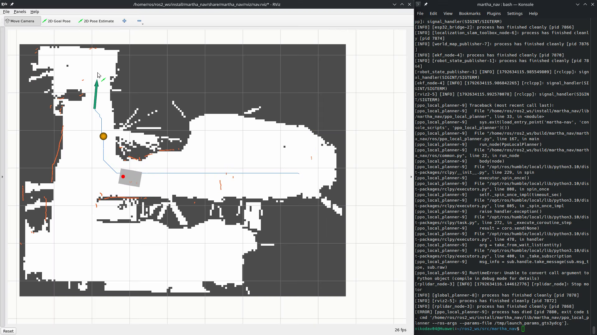](https://github.com/Mocolax/martha_nav/releases/download/evidencias-pruebas-fisicas/R1_laboratorio_pantalla_rviz.mp4)

**[Descargar MP4](https://github.com/Mocolax/martha_nav/releases/download/evidencias-pruebas-fisicas/R1_laboratorio_pantalla_rviz.mp4)**

### Laboratorio

Registros de la preparación y del desplazamiento de MARTHA. No permiten medir
el recorrido completo.

| Registro | Duración | Qué muestra | Video |
|---|---:|---|---|
| V2 | 124,2 s | Partida con obstáculos y meta; movimiento visto en RViz. | [Descargar MP4](https://github.com/Mocolax/martha_nav/releases/download/evidencias-pruebas-fisicas/V02_laboratorio.mp4) |
| V3 | 73,9 s | Preparación y parte del desplazamiento. | [Descargar MP4](https://github.com/Mocolax/martha_nav/releases/download/evidencias-pruebas-fisicas/V03_laboratorio.mp4) |
| V5 | 47,8 s | Seguimiento parcial del robot. | [Descargar MP4](https://github.com/Mocolax/martha_nav/releases/download/evidencias-pruebas-fisicas/V05_laboratorio.mp4) |
| V7 | 55,2 s | Seguimiento parcial del robot. | [Descargar MP4](https://github.com/Mocolax/martha_nav/releases/download/evidencias-pruebas-fisicas/V07_laboratorio.mp4) |

### Salón

| Registro | Duración | Qué muestra | Video |
|---|---:|---|---|
| V8 | 75,0 s | RViz muestra A y B; pasa entre la mochila y el cubo. Movimiento estimado: ≈22 s. | [Descargar MP4](https://github.com/Mocolax/martha_nav/releases/download/evidencias-pruebas-fisicas/V08_salon.mp4) |
| V9 | 33,2 s | Cámara casi fija; pasa junto a la mochila. Movimiento estimado: ≈18 s. | [Descargar MP4](https://github.com/Mocolax/martha_nav/releases/download/evidencias-pruebas-fisicas/V09_salon.mp4) |
| V10 | 37,9 s | Cubo junto a la partida; llega al extremo opuesto. Movimiento estimado: ≈23 s. | [Descargar MP4](https://github.com/Mocolax/martha_nav/releases/download/evidencias-pruebas-fisicas/V10_salon.mp4) |
| V11 | 50,9 s | Video vertical; no delimita el recorrido. | [Descargar MP4](https://github.com/Mocolax/martha_nav/releases/download/evidencias-pruebas-fisicas/V11_salon_vertical.mp4) |

**Cómo consultar los videos.** Los enlaces descargan los MP4; las imágenes de esta
página son fotogramas, no reproductores integrados.

**Duración y movimiento.** La duración incluye preparación y movimientos de cámara.
Los tiempos de movimiento de V8 a V10 son estimaciones con un margen de ±3 s;
entre los videos seleccionados, solo R1 permite medir el recorrido completo.

Los videos de teléfono están estabilizados, con reducción leve de ruido, audio
normalizado y un rótulo inferior con el nombre y el tiempo. Conservan la duración
original. R1 es una grabación de pantalla de RViz (1920×1080), con el mismo rótulo
y sin estabilizar.

El [inventario histórico](registros_audiovisuales.csv) conserva los nombres originales
de los 12 registros documentados. Esta selección utiliza únicamente los nueve
videos publicados; V1, V4 y V6 quedan fuera de la selección. Sus fotogramas se
conservan en la galería como evidencia fotográfica.

---

## Galería visual

Selecciona una imagen para abrirla en su tamaño original.

### Robot y escenarios

| Evidencia | Evidencia |
|:---:|:---:|
| [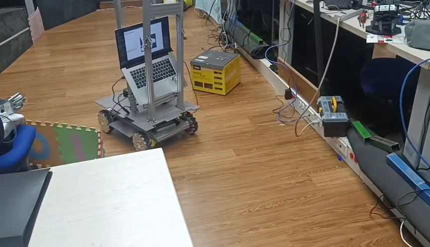](fotos/12_video2_01m24s_martha_fisico.png) 12 video2 01m24s martha fisico | [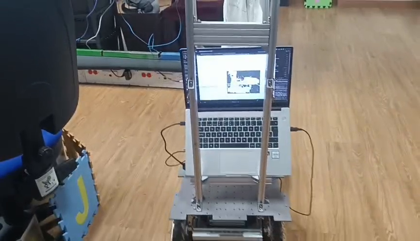](fotos/13_video3_00m51s_martha_fisico.png) 13 video3 00m51s martha fisico |
| [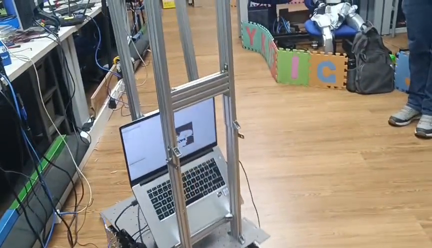](fotos/14_video5_00m25s_martha_fisico.png) 14 video5 00m25s martha fisico | [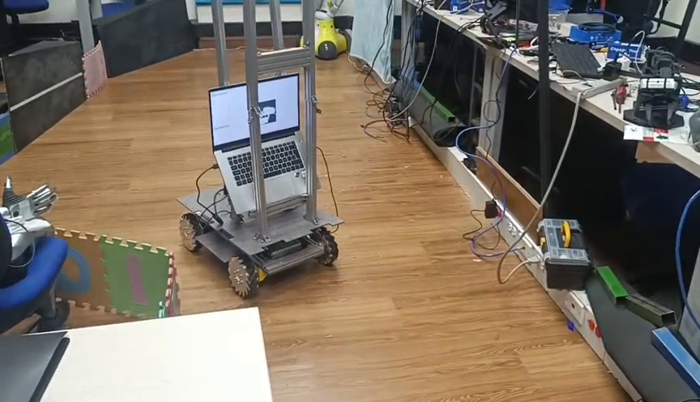](fotos/15_video7_00m47s_martha_fisico.png) 15 video7 00m47s martha fisico |
| [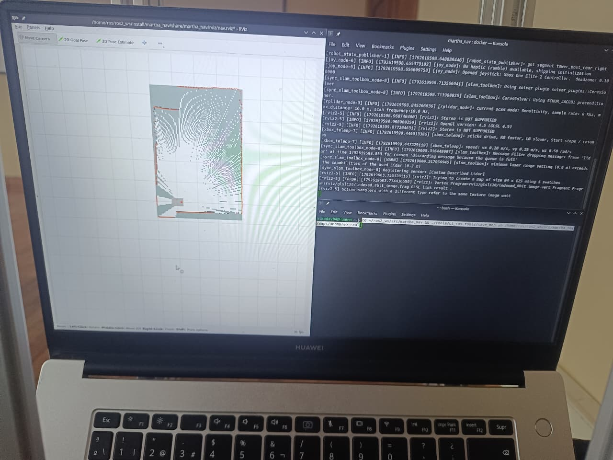](fotos/16_salon_mapeo_consola_rviz.jpeg) 16 salon mapeo consola rviz | [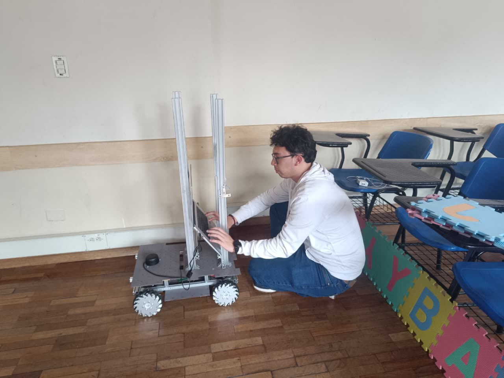](fotos/17_salon_preparacion_robot.jpeg) 17 salon preparacion robot |
| [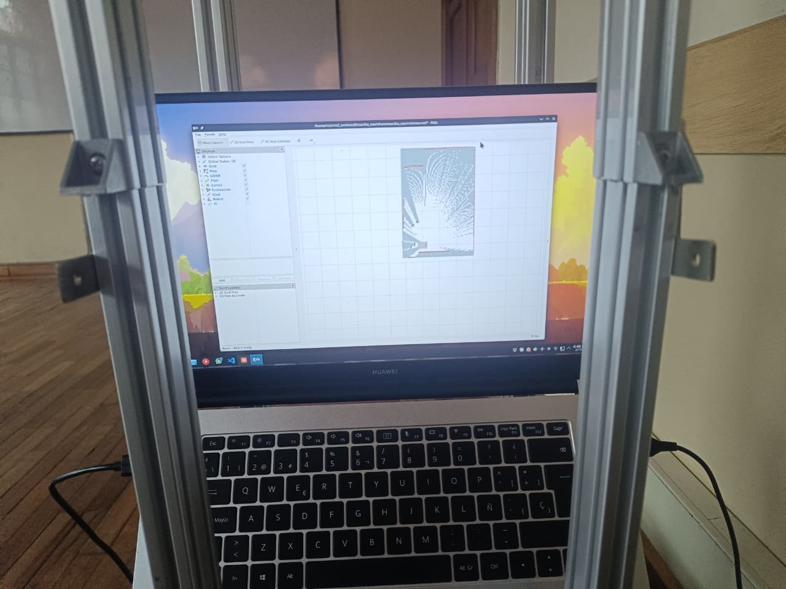](fotos/18_salon_mapa_rviz_torre.jpeg) 18 salon mapa rviz torre |  |

### Mapas y navegación en RViz

| Evidencia | Evidencia |
|:---:|:---:|
| [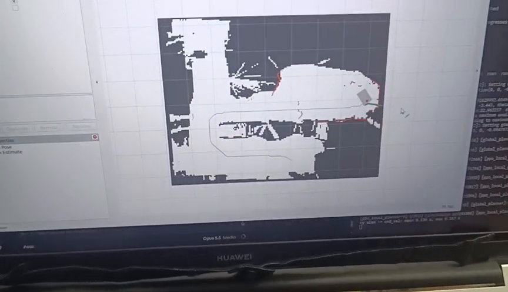](fotos/01_video2_01m44s_rviz_mapa_ruta_goal.png) 01 video2 01m44s rviz mapa ruta goal | [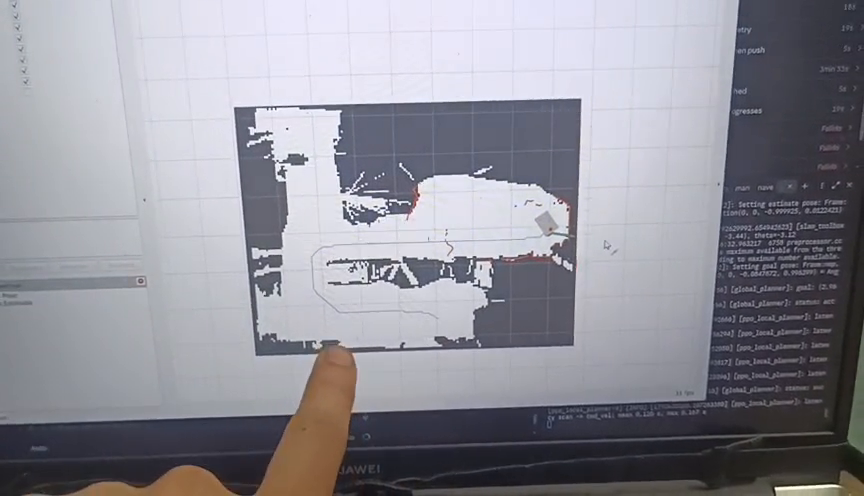](fotos/02_video2_01m49s_rviz_mapa_log_goal_ppo.png) 02 video2 01m49s rviz mapa log goal ppo |
| [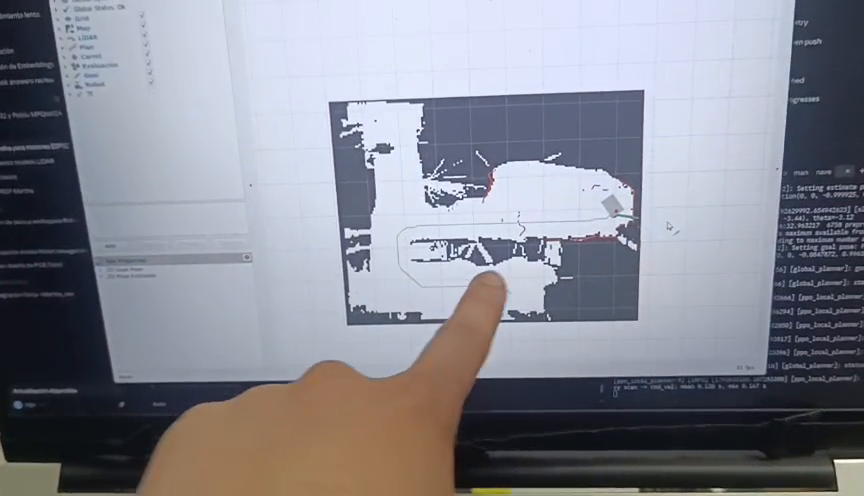](fotos/03_video2_01m58s_rviz_mapa_ruta_goal.png) 03 video2 01m58s rviz mapa ruta goal | [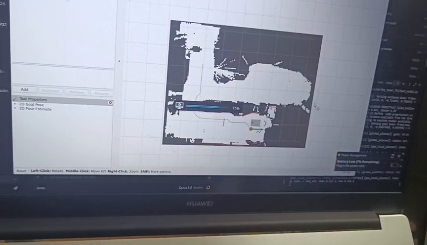](fotos/04_video4_00m45s_rviz_2DGoalPose_progreso75.png) 04 video4 00m45s rviz 2DGoalPose progreso75 |
| [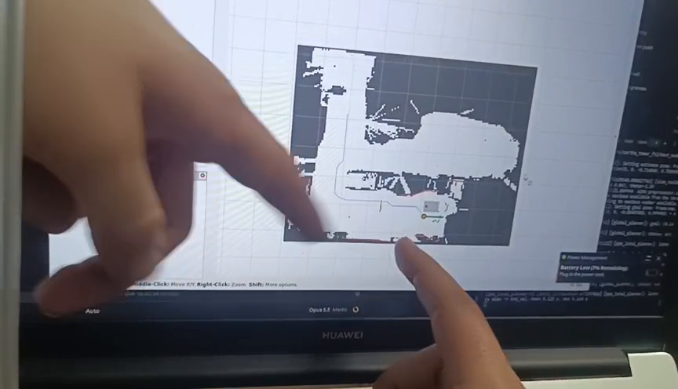](fotos/05_video4_00m46s_rviz_2DGoalPose_ruta.png) 05 video4 00m46s rviz 2DGoalPose ruta | [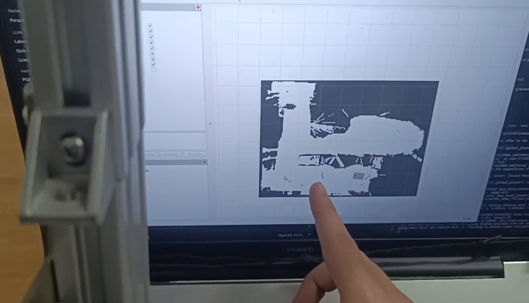](fotos/07_video1_00m45s_rviz_mapa_robot.png) 07 video1 00m45s rviz mapa robot |
| [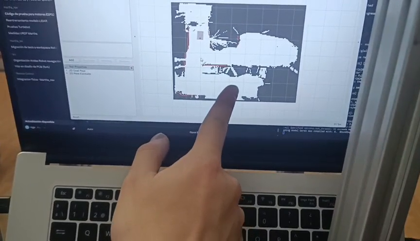](fotos/08_video3_00m37s_rviz_mapa_cargado.png) 08 video3 00m37s rviz mapa cargado | [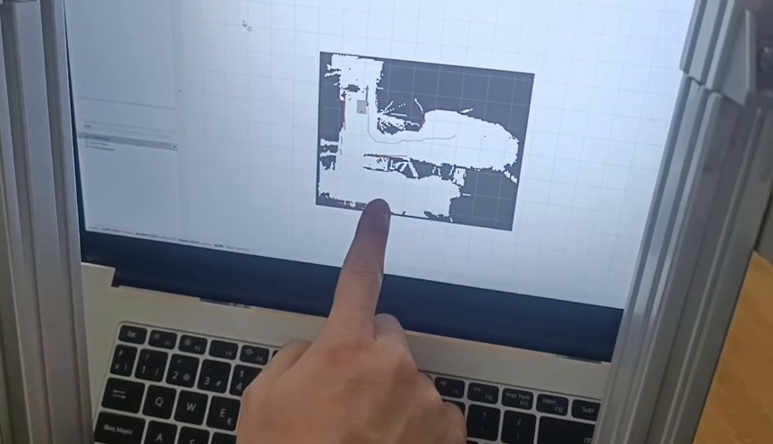](fotos/09_video6_00m27s_rviz_mapa_cargado.png) 09 video6 00m27s rviz mapa cargado |
| [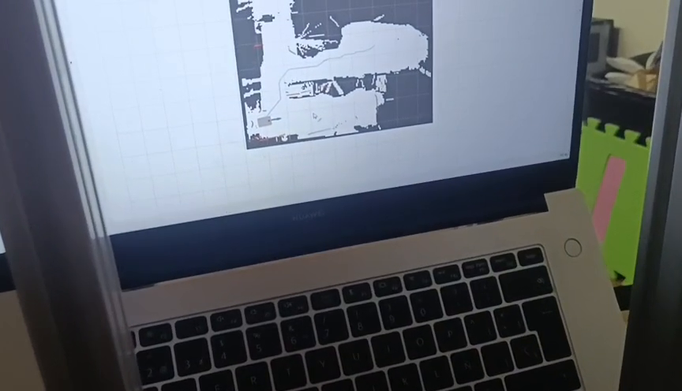](fotos/10_video7_00m16s_rviz_robot_en_ruta.png) 10 video7 00m16s rviz robot en ruta | [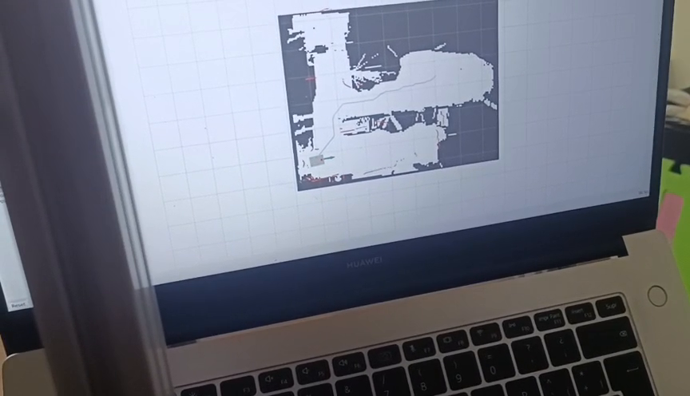](fotos/11_video7_00m20s_rviz_robot_en_ruta.png) 11 video7 00m20s rviz robot en ruta |
| [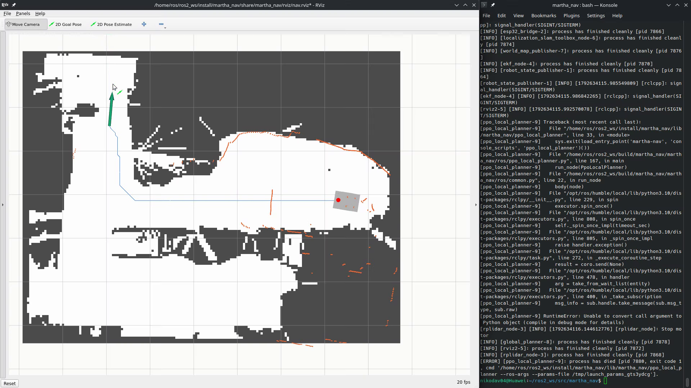](fotos/19_R1_00m06s_rviz_goal_ruta_robot.png) 19 R1 00m06s rviz goal ruta robot | [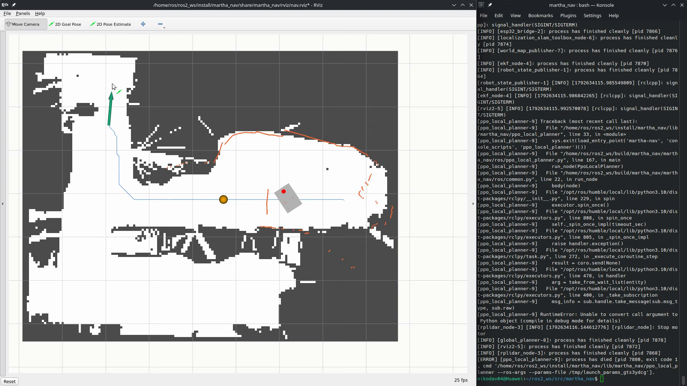](fotos/19_R1_00m15s_rviz_goal_ruta_robot.png) 19 R1 00m15s rviz goal ruta robot |
|  19 R1 00m27s rviz goal ruta robot | [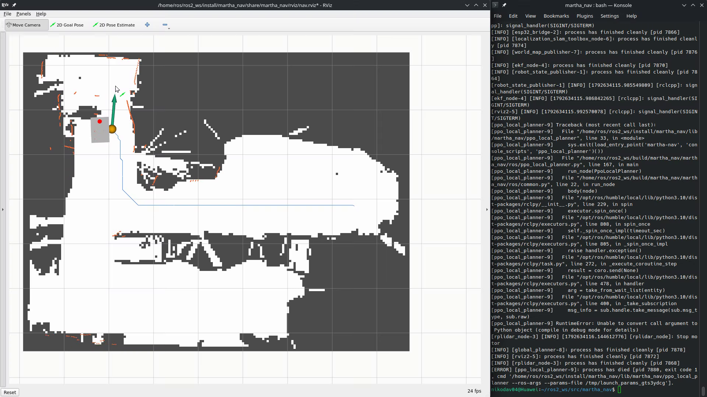](fotos/19_R1_00m36s_rviz_goal_ruta_robot.png) 19 R1 00m36s rviz goal ruta robot |

## Aciertos y fallas

Se realizaron 12 pruebas de A a B: 10 alcanzaron la meta y 2 fallaron.

| Escenario | Pruebas | Aciertos | Fallas |
|---|---:|---:|---:|
| Laboratorio de robótica | 8 | 6 | 2 |
| Salón controlado | 4 | 4 | 0 |
| **Total** | **12** | **10** | **2** |

**Todos los videos de esta página corresponden a aciertos.** Las dos fallas, ambas
en el laboratorio, fueron una colisión con un obstáculo y el desprendimiento de una
rueda (falla mecánica). **Las fallas no tienen video**: no se grabaron o no se
conservaron, por lo que solo constan en el registro de los autores. Los registros audiovisuales
no se corresponden uno a uno con las 12 pruebas: hay pruebas exitosas con más de un
registro y fallas sin ninguno.

## Fotografías

Fotogramas extraídos de los videos, con su resolución original, y fotografías del
salón. El nombre indica el número de imagen, el registro de origen y la marca
temporal: `12_video2_01m24s_martha_fisico.png` es la imagen 12 del registro V2 en
01:24.

| Archivo | Contenido |
|---|---|
| `01`–`03_video2_…` | RViz: mapa, ruta global, meta y registro de ejecución (V2). |
| `04`, `05_video4_…` | Herramienta 2D Goal Pose y ruta en RViz (V4). |
| `07_video1_…` | Mapa y robot en RViz (V1). |
| `08_video3_…`, `09_video6_…` | Mapa cargado en RViz (V3, V6). |
| `10`, `11_video7_…` | Robot siguiendo la ruta en RViz (V7). |
| `12`–`15_…_martha_fisico.png` | MARTHA en el laboratorio (V2, V3, V5, V7). |
| `16_salon_mapeo_consola_rviz.jpeg` | Mapeo del salón: RViz y consola. |
| `17_salon_preparacion_robot.jpeg` | Preparación del robot en el salón. |
| `18_salon_mapa_rviz_torre.jpeg` | Mapa del salón en RViz, visto a través de la torre de MARTHA. |
| `19_R1_…_rviz_goal_ruta_robot.png` | Meta, ruta y robot en la grabación de pantalla R1 (00:06, 00:15, 00:27, 00:36). |

## Límites

La posición que muestran RViz y la trayectoria es la que estima el sistema
(slam_toolbox y EKF), no una verdad de terreno independiente.
