# Evidencias de las pruebas físicas de MARTHA

Registros audiovisuales y fotografías de las pruebas de navegación de MARTHA en el
laboratorio de robótica (21 de octubre de 2026) y en un salón controlado (22 de
octubre de 2026). Corresponden a la sección 6.4.4 y al Anexo E de la tesis.

**Fotografías disponibles en esta galería. Videos pendientes de publicación.**
El inventario conserva los 12 registros documentados; la carpeta preparada para subir
contiene 9 videos. Faltan V1, V4 y V6. Las fotografías están en [`fotos/`](fotos/).

## Galería visual

Selecciona una imagen para abrirla en su tamaño original.

### Robot y escenarios

| Evidencia | Evidencia |
|:---:|:---:|
| [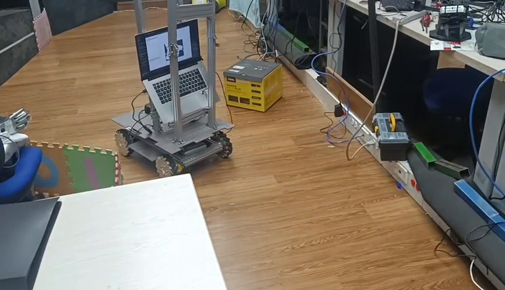](fotos/12_video2_01m24s_martha_fisico.png) 12 video2 01m24s martha fisico | [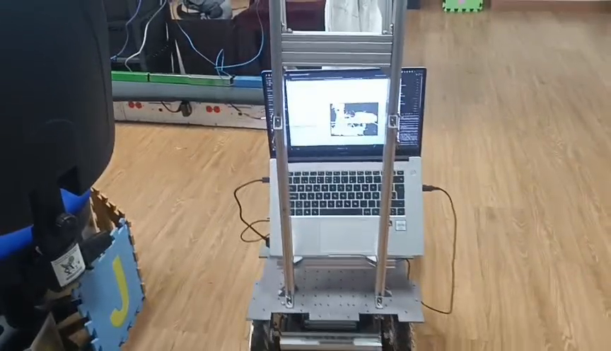](fotos/13_video3_00m51s_martha_fisico.png) 13 video3 00m51s martha fisico |
|  14 video5 00m25s martha fisico |  15 video7 00m47s martha fisico |
| [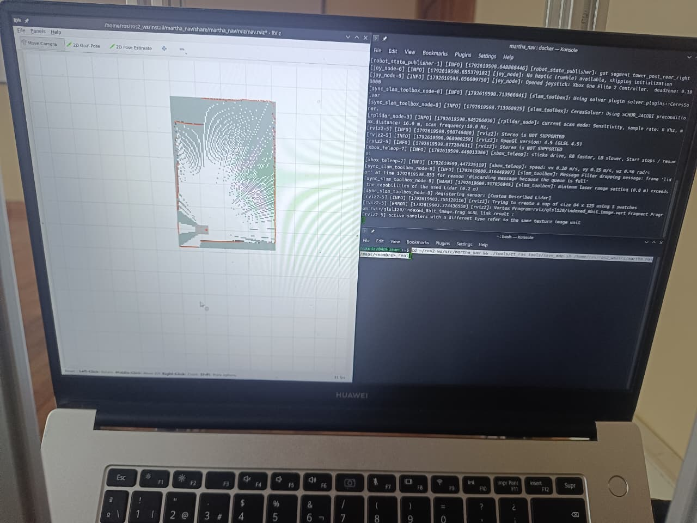](fotos/16_salon_mapeo_consola_rviz.jpeg) 16 salon mapeo consola rviz | [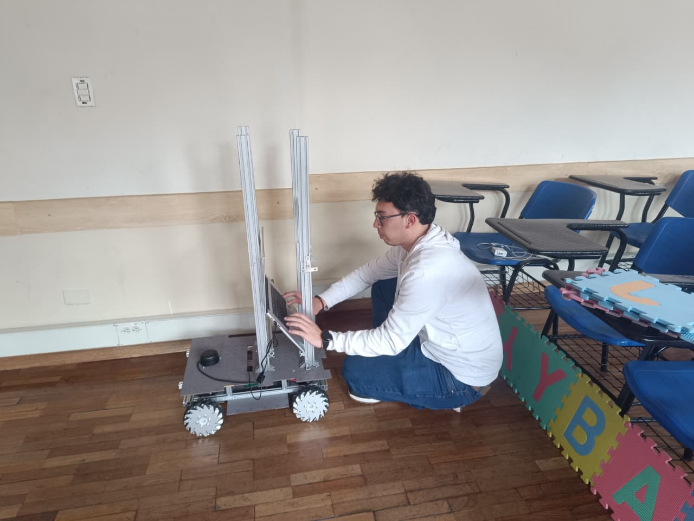](fotos/17_salon_preparacion_robot.jpeg) 17 salon preparacion robot |
| [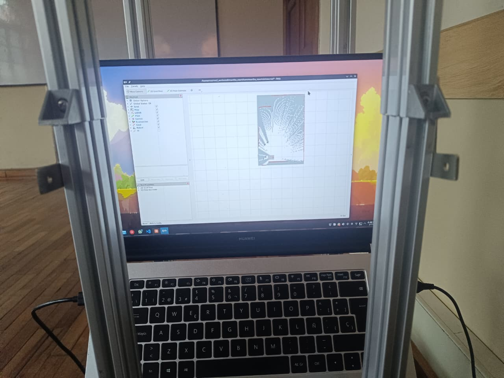](fotos/18_salon_mapa_rviz_torre.jpeg) 18 salon mapa rviz torre |  |

### Mapas y navegación en RViz

| Evidencia | Evidencia |
|:---:|:---:|
| [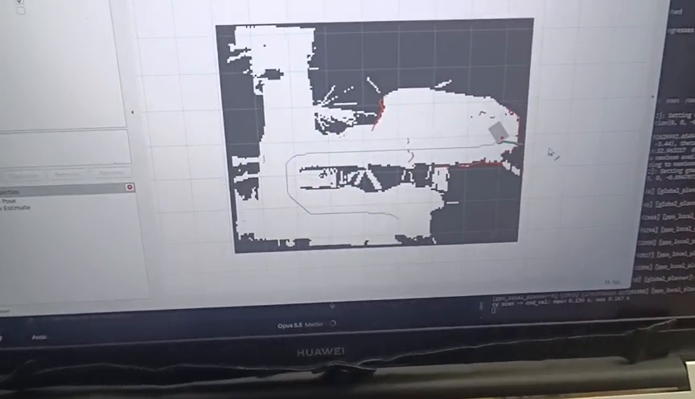](fotos/01_video2_01m44s_rviz_mapa_ruta_goal.png) 01 video2 01m44s rviz mapa ruta goal | [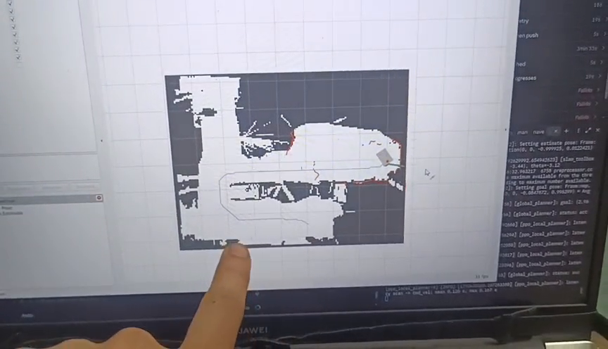](fotos/02_video2_01m49s_rviz_mapa_log_goal_ppo.png) 02 video2 01m49s rviz mapa log goal ppo |
|  03 video2 01m58s rviz mapa ruta goal | [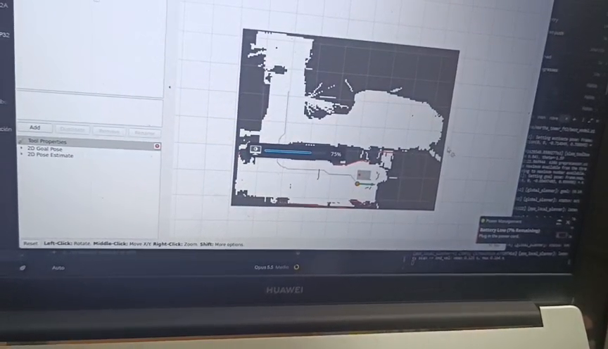](fotos/04_video4_00m45s_rviz_2DGoalPose_progreso75.png) 04 video4 00m45s rviz 2DGoalPose progreso75 |
| [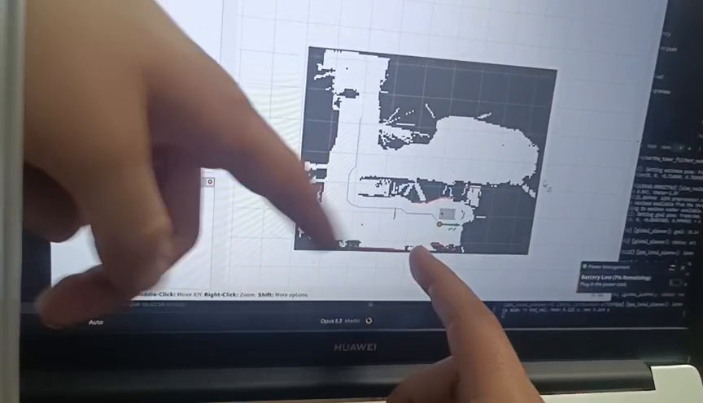](fotos/05_video4_00m46s_rviz_2DGoalPose_ruta.png) 05 video4 00m46s rviz 2DGoalPose ruta | [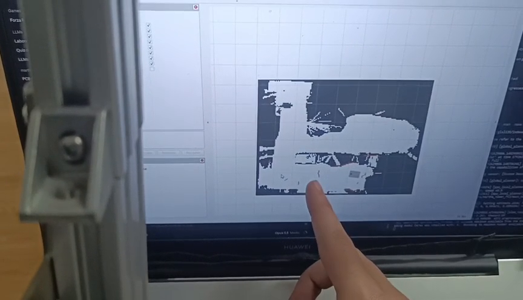](fotos/07_video1_00m45s_rviz_mapa_robot.png) 07 video1 00m45s rviz mapa robot |
| [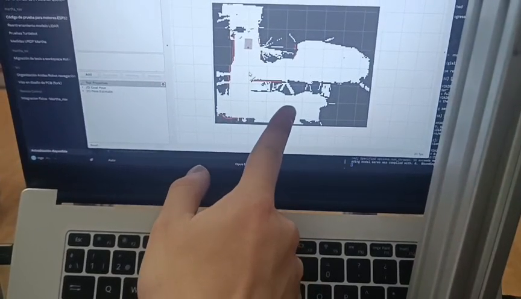](fotos/08_video3_00m37s_rviz_mapa_cargado.png) 08 video3 00m37s rviz mapa cargado | [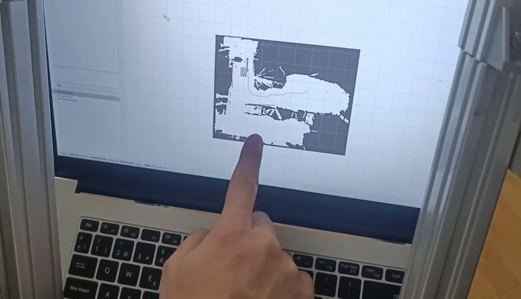](fotos/09_video6_00m27s_rviz_mapa_cargado.png) 09 video6 00m27s rviz mapa cargado |
| [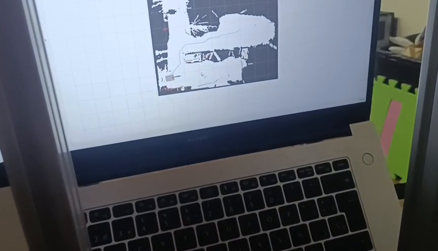](fotos/10_video7_00m16s_rviz_robot_en_ruta.png) 10 video7 00m16s rviz robot en ruta | [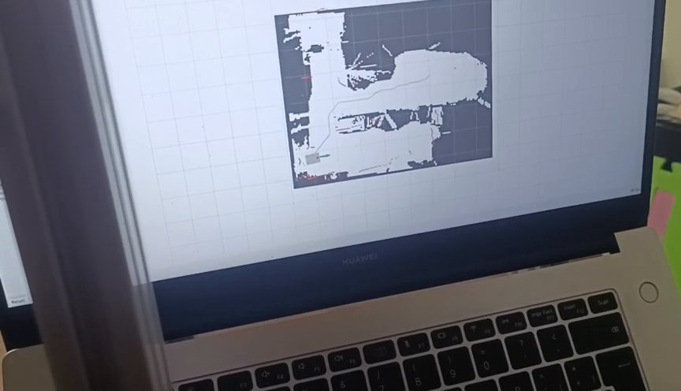](fotos/11_video7_00m20s_rviz_robot_en_ruta.png) 11 video7 00m20s rviz robot en ruta |
| [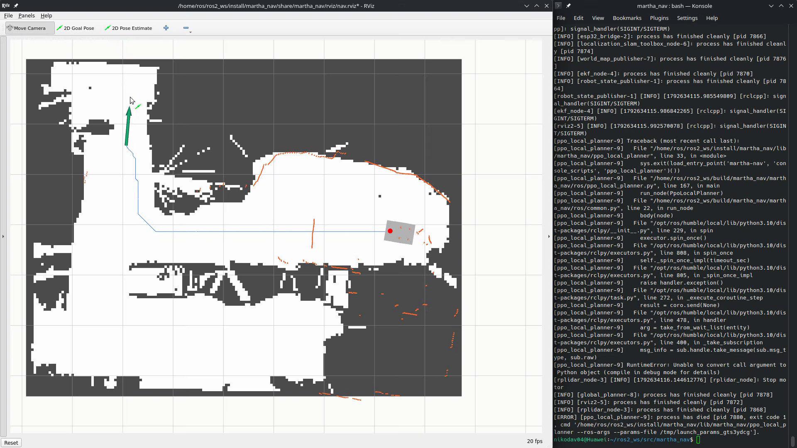](fotos/19_R1_00m06s_rviz_goal_ruta_robot.png) 19 R1 00m06s rviz goal ruta robot | [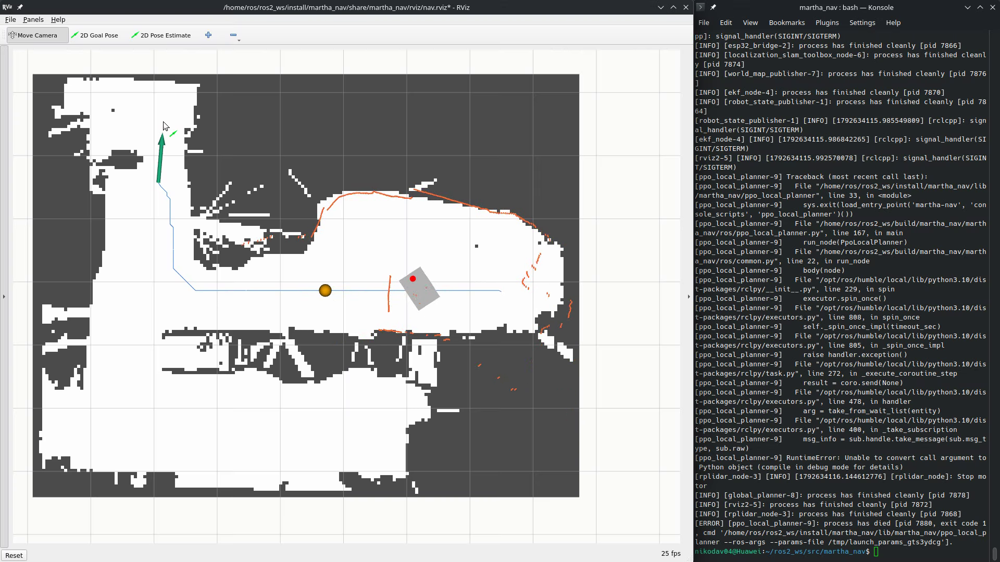](fotos/19_R1_00m15s_rviz_goal_ruta_robot.png) 19 R1 00m15s rviz goal ruta robot |
|  19 R1 00m27s rviz goal ruta robot | [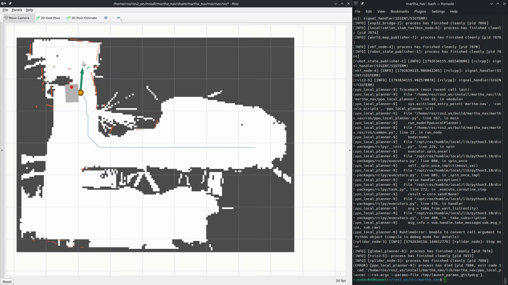](fotos/19_R1_00m36s_rviz_goal_ruta_robot.png) 19 R1 00m36s rviz goal ruta robot |

## Videos

Los videos de teléfono están estabilizados, con reducción leve de ruido, audio
normalizado y un rótulo inferior con el nombre y el tiempo. Conservan la duración
original: no se cortó nada. R1 es una grabación de pantalla de RViz (1920×1080) con
el mismo rótulo, sin estabilizar.

| Registro | Escenario | Duración (s) | Movimiento (s) | Observación | Video |
|---|---|---:|---:|---|---|
| V1 | Laboratorio | 77.8 | – | Preparación y mapa en pantalla. | `V01_laboratorio.mp4` · pendiente |
| V2 | Laboratorio | 124.2 | – | Partida con obstáculos y meta; movimiento visto en RViz. | `V02_laboratorio.mp4` · pendiente |
| V3 | Laboratorio | 73.9 | – | Preparación y parte del desplazamiento. | `V03_laboratorio.mp4` · pendiente |
| V4 | Laboratorio | 84.3 | – | Preparación y parte del desplazamiento. | `V04_laboratorio.mp4` · pendiente |
| V5 | Laboratorio | 47.8 | – | Seguimiento parcial del robot. | `V05_laboratorio.mp4` · pendiente |
| V6 | Laboratorio | 58.1 | – | Seguimiento parcial del robot. | `V06_laboratorio.mp4` · pendiente |
| V7 | Laboratorio | 55.2 | – | Seguimiento parcial del robot. | `V07_laboratorio.mp4` · pendiente |
| R1 | Laboratorio | 45.1 | 29.4 | Pantalla de RViz de una ejecución exitosa (inicio 6.4 s, llegada 35.8 s). | `R1_laboratorio_pantalla_rviz.mp4` · pendiente |
| V8 | Salón | 75.0 | ≈22 | RViz muestra A y B; pasa entre la mochila y el cubo. | `V08_salon.mp4` · pendiente |
| V9 | Salón | 33.2 | ≈18 | Cámara casi fija; pasa junto a la mochila. | `V09_salon.mp4` · pendiente |
| V10 | Salón | 37.9 | ≈23 | Cubo junto a la partida; llega al extremo opuesto. | `V10_salon.mp4` · pendiente |
| V11 | Salón | 50.9 | – | Video vertical; no delimita el recorrido. | `V11_salon_vertical.mp4` · pendiente |

Los tiempos de movimiento de V8 a V10 se estimaron viendo el video (±3 s); solo R1
permite medir el recorrido completo. La duración de un video de teléfono no equivale
al tiempo de recorrido, porque incluye preparación y movimientos de cámara.
[`registros_audiovisuales.csv`](registros_audiovisuales.csv) contiene el mismo
inventario con el nombre del archivo original de cada registro.

## Aciertos y fallas

Se realizaron 12 pruebas de A a B: 10 alcanzaron la meta y 2 fallaron.

| Escenario | Pruebas | Aciertos | Fallas |
|---|---:|---:|---:|
| Laboratorio de robótica | 8 | 6 | 2 |
| Salón controlado | 4 | 4 | 0 |
| **Total** | **12** | **10** | **2** |

**Todos los videos de esta página corresponden a aciertos.** Las dos fallas, ambas
en el laboratorio, fueron una colisión con un obstáculo y el desprendimiento de una
rueda (falla mecánica). **Las fallas no tienen video**: no se grabaron o no se
conservaron, por lo que solo constan en el registro de los autores. Los 12 archivos
no se corresponden uno a uno con las 12 pruebas: hay pruebas exitosas con más de un
registro y fallas sin ninguno.

## Fotografías

Fotogramas extraídos de los videos, con su resolución original, y fotografías del
salón. El nombre indica el número de imagen, el registro de origen y la marca
temporal: `12_video2_01m24s_martha_fisico.png` es la imagen 12 del registro V2 en
01:24.

| Archivo | Contenido |
|---|---|
| `01`–`03_video2_…` | RViz: mapa, ruta global, meta y registro de ejecución (V2). |
| `04`, `05_video4_…` | Herramienta 2D Goal Pose y ruta en RViz (V4). |
| `07_video1_…` | Mapa y robot en RViz (V1). |
| `08_video3_…`, `09_video6_…` | Mapa cargado en RViz (V3, V6). |
| `10`, `11_video7_…` | Robot siguiendo la ruta en RViz (V7). |
| `12`–`15_…_martha_fisico.png` | MARTHA en el laboratorio (V2, V3, V5, V7). |
| `16_salon_mapeo_consola_rviz.jpeg` | Mapeo del salón: RViz y consola. |
| `17_salon_preparacion_robot.jpeg` | Preparación del robot en el salón. |
| `18_salon_mapa_rviz_torre.jpeg` | Mapa del salón en RViz, visto a través de la torre de MARTHA. |
| `19_R1_…_rviz_goal_ruta_robot.png` | Meta, ruta y robot en la grabación de pantalla R1 (00:06, 00:15, 00:27, 00:36). |

## Límites

La posición que muestran RViz y la trayectoria es la que estima el sistema
(slam_toolbox y EKF), no una verdad de terreno independiente.
