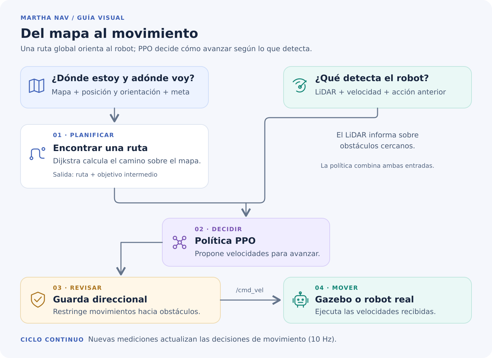

# Manual de usuario — Martha Nav

`martha_nav` implementa un sistema de navegación para el robot móvil Martha. Combina planificación global sobre un mapa con un planificador
local aprendido mediante **PPO (Proximal Policy Optimization)**: la ruta indica por
dónde llegar y la política usa el LiDAR para ajustar las velocidades ante obstáculos.

El proyecto incluye entrenamiento en un simulador 2D propio, evaluación en Gazebo
Classic, visualización en RViz y componentes para desplegar la navegación en robots
reales. Se desarrolló como parte del trabajo de tesis sobre el planificador local
de Martha. Este manual describe la rama `feat/sim2d-training`.

[← Volver a la portada](../README.md)

## Contenido

- [Trabajo realizado](#trabajo-realizado)
- [Cómo funciona](#cómo-funciona)
- [Organización del repositorio](#organización-del-repositorio)
- [Requisitos e instalación](#requisitos-e-instalación)
- [Manual de simulación](#manual-de-simulación)
- [Entrenamiento y evaluación](#entrenamiento-y-evaluación)
- [Uso en el robot real](#uso-en-el-robot-real)
- [Resultados](#resultados)
- [Pruebas y solución de problemas](#pruebas-y-solución-de-problemas)
- [Documentación complementaria](#documentación-complementaria)

## Trabajo realizado

| Componente | Desarrollo incluido |
|---|---|
| Simulador 2D | Entorno de aprendizaje con cinemática, LiDAR, colisiones, mapas rasterizados desde archivos `.world`, escenarios paramétricos y obstáculos que no aparecen en el mapa global. |
| Planificación global | Rutas mediante Dijkstra sobre una rejilla de ocupación inflada, seguimiento del avance y selección de un punto objetivo intermedio (*carrot* o zanahoria). |
| Aprendizaje | PPO con extractor CNN para el LiDAR, registro de recompensas, evaluación periódica y selección del mejor modelo; variantes con movimiento lateral, memoria LSTM y recompensa geodésica. |
| Transferencia a Gazebo | Modelos de robot, mundos, sensores, control mecanum o movimiento planar, transformaciones TF y evaluación por episodios. |
| Navegación ROS 2 | Nodos de mapa, planificación global, inferencia de la política, publicación de velocidades, cancelación de metas y guarda direccional ante obstáculos. |
| Localización | Integración con `slam_toolbox` para mapear y localizarse en el robot real; en simulación se usa la pose verdadera de Gazebo. |
| Martha real | Firmware ESP32, control de motores, encoders, giroscopio, puente serial, RPLIDAR y fusión de odometría mediante EKF. |
| Análisis experimental | Comparación de configuraciones, transferencia 2D–Gazebo, trayectorias, éxito, colisiones, estancamientos, SPL y bitácoras de resultados. |
| Verificación | Pruebas del simulador, recompensas, políticas, geometría, nodos, launch, URDF e interfaces de hardware. |

## Cómo funciona



[Ver el diagrama en formato vectorial](../docs/como-funciona.svg).

El LiDAR se reduce a **90 sectores** y sus distancias se codifican como `d/(d+1)`.
La observación reúne esos sectores, distancia y ángulo al objetivo intermedio,
velocidad medida y acción anterior: 96 valores con dos acciones o 98 con tres.
El nodo local calcula comandos a **10 Hz** y detiene el movimiento si faltan datos
recientes de los sensores.

Hay dos perfiles en [`martha_nav/robots.py`](../martha_nav/robots.py):

| Perfil | Plataforma | Particularidad |
|---|---|---|
| `martha` | Base con ruedas mecanum | Permite acciones `(v, w)` o `(vx, vy, w)`, según el modelo entrenado. |
| `martha_tower` | Martha con torre de aluminio y elevador de la garra | Modela los postes y los motores del elevador que atraviesan el plano del LiDAR, con el LiDAR a 0.195 m (medido el 2026-11-24). Requiere una política compatible con ese perfil. |

Se incluyen cinco políticas listas para inferencia:

| Archivo | Entrenamiento de origen | Acciones |
|---|---|---|
| [`policies/martha.npz`](../policies/martha.npz) | `martha_tower_scratch_s0` (perfil `martha_tower`) | Avance/retroceso y giro; **no ordena movimiento lateral**. |
| [`policies/martha_holo.npz`](../policies/martha_holo.npz) | `martha_tower_holo_s0` (perfil `martha_tower`) | Avance/retroceso, **lateral** y giro (acción holonómica). |
| [`policies/martha_tower_holo_5m.npz`](../policies/martha_tower_holo_5m.npz) | `martha_claw_holo_5m_s0` (torre con la garra) | Holonómica, 5M pasos. |
| [`policies/martha_tower_holo_rev.npz`](../policies/martha_tower_holo_rev.npz) | `martha_claw_holo_rev_s0` (torre con la garra) | Holonómica, 5M pasos, castigo por metro en reversa (`--reward-reverse 1.0`). |
| [`policies/martha_tower_holo_clear.npz`](../policies/martha_tower_holo_clear.npz) | `martha_claw_holo_clear_s0` (torre con la garra) | Holonómica, 5M pasos, castigo denso por cercanía a obstáculos (`--reward-clearance 0.05`). |

Los `.npz` ejecutan la inferencia con NumPy, sin PyTorch. Los checkpoints `.zip`
necesitan las dependencias de aprendizaje y su `config.yaml` asociado. El cargador comprueba
la compatibilidad del perfil; no basta con cambiar el nombre del robot para reutilizar una política.

`martha.npz` y `martha_holo.npz` se entrenaron con la torre antes del elevador de la garra (LiDAR a 0.19 m,
solo los cuatro postes). Con el perfil actual el cargador las rechaza: en la torre de hoy
se usan `martha_tower_holo_5m.npz`, `martha_tower_holo_rev.npz` o
`martha_tower_holo_clear.npz`.

## Organización del repositorio

```text
martha_nav/
├── sim.sh           # Simulación en el PC: Gazebo, política, teleop, evaluaciones
├── robot.sh         # Robot real: mapear, localizar, política, teleop, pruebas de la ESP32
├── docker/          # Imagen y contenedor ros2_humble (los usan sim.sh y robot.sh)
├── martha_nav/
│   ├── sim2d/       # Simulador, observaciones, recompensa y planificación
│   ├── learning/    # Entrenamiento, evaluación y exportación
│   ├── ros/         # Nodos e integración ROS 2
│   └── robots.py    # Perfiles de robot
├── launch/          # sim.launch.py, real.launch.py y policy.launch.py
├── policies/        # Políticas NumPy incluidas
├── config/          # Controladores, EKF, LiDAR y puntos de evaluación
├── urdf/            # Modelo de Martha
├── worlds/          # Escenarios de Gazebo
├── rviz/            # Configuración de visualización
├── firmware/        # Programa de la ESP32 y control de hardware
├── tools/           # Gráficas, paquete de entrega y comprobaciones del hardware
├── test/            # Pruebas automatizadas
└── docs/            # Manual, resultados y referencias
```

`runs/`, `maps/` y `entrega_tesis/` son salidas locales excluidas de Git. Un clon
nuevo no contiene los checkpoints históricos, mapas guardados ni todos los CSV
mencionados en las bitácoras. `docs/entrega/` describe el paquete de evidencias,
pero no contiene ese paquete completo.

## Requisitos e instalación

### Con Docker (recomendado)

Todo corre en el contenedor `ros2_humble` (ROS 2 Humble, Gazebo Classic 11 y PyTorch
para CPU), definido en [`docker/`](../docker/). Solo se necesitan Docker con el plugin
`compose` y una sesión gráfica. El repositorio va dentro de un workspace de colcon,
porque el contenedor monta el workspace completo y compila en él:

```bash
mkdir -p ~/ros2_ws/src
git clone --branch feat/sim2d-training https://github.com/Mocolax/martha_nav.git ~/ros2_ws/src/martha_nav
cd ~/ros2_ws/src/martha_nav
./sim.sh test
```

La primera vez construye la imagen y compila el workspace; después arranca el
contenedor si está detenido. Los comandos se escriben **en el anfitrión**, desde la raíz
del repositorio. `./sim.sh` y `./robot.sh` sin argumentos válidos muestran su ayuda.

| Comando | Uso |
|---|---|
| `./sim.sh shell` | Terminal dentro del contenedor, en el repositorio, con ROS cargado. |
| `./sim.sh build` | Recompilar después de cambiar `setup.py`, launch, URDF, configuración o mundos. |
| `./sim.sh stop` | Detener el contenedor; el código, `runs/` y `maps/` quedan en el anfitrión. |

### Instalación nativa

El entorno documentado del proyecto utiliza **ROS 2 Humble** y **Gazebo Classic**.
Para una instalación nativa, la base habitual es Ubuntu 22.04 con ROS 2 Humble ya
instalado. Se necesitan `colcon`, `rosdep`, NumPy, SciPy, PyYAML y las dependencias
de [`package.xml`](../package.xml). RViz requiere además `rviz2` y una sesión gráfica.

Sin Docker, los siguientes comandos preparan un workspace nativo. No instalan ROS
desde cero, y `sim.sh` y `robot.sh` no sirven en ese caso: se usan los `ros2 launch`
que esos scripts muestran en su código.

```bash
source /opt/ros/humble/setup.bash
mkdir -p ~/ros2_ws/src
cd ~/ros2_ws/src
git clone --branch feat/sim2d-training https://github.com/Mocolax/martha_nav.git
cd ~/ros2_ws
rosdep update
rosdep install --from-paths src/martha_nav --ignore-src -r -y
colcon build --packages-select martha_nav --symlink-install
source install/setup.bash
cd src/martha_nav
```

`rosdep` debe estar inicializado previamente; si indica lo contrario, ejecutar una
vez `sudo rosdep init` y repetir `rosdep update`. Revisar que la resolución de
dependencias termine correctamente antes de compilar. La simulación mecanum exige
`mecanum_drive_controller` compatible con Humble, además de `gazebo_ros2_control`;
este repositorio no incluye el código de ese controlador. Si no está disponible,
puede utilizarse `drive:=planar` para la demostración sin dinámica de ruedas.

En **cada terminal nueva** cargar ROS y el workspace:

```bash
source /opt/ros/humble/setup.bash
source ~/ros2_ws/install/setup.bash
cd ~/ros2_ws/src/martha_nav
```

### Dependencias de entrenamiento

La navegación con las políticas `.npz` incluidas no necesita instalar el conjunto
de aprendizaje. Para entrenar, evaluar checkpoints `.zip` o exportarlos, instalar
[`requirements.txt`](../requirements.txt) en un entorno compatible con ROS. Por ejemplo,
desde la raíz del repositorio, con el soporte `python3-venv` instalado:

```bash
python3 -m venv --system-site-packages ~/venvs/martha-nav
source ~/venvs/martha-nav/bin/activate
python3 -m pip install -r requirements.txt scipy pyyaml pytest
```

Las versiones declaradas incluyen Stable-Baselines3 2.3.2 y sb3-contrib 2.3.0,
con NumPy anterior a 2. PyTorch y Gymnasium se instalan como dependencias del
aprendizaje. Los ejemplos 2D de este manual usan `python3 -m` desde la raíz del
repositorio para seleccionar el intérprete del entorno activado. No es necesario
tener Gazebo abierto para entrenar.

## Manual de simulación

Cada comando en su propia terminal: primero el mundo y, encima, la política o el
teclado.

### 1. Abrir un mundo

```bash
./sim.sh            # lab
./sim.sh hall
```

Abre Gazebo y RViz con Martha, sin política. Los mundos son `lab`, `room`, `hall`,
`multi`, `tube`, `four_rooms`, `roblab` y `robocup_casa` (`worlds/`). Martha aparece
donde empieza el primer episodio de evaluación de ese mundo, así que nunca dentro de
una pared. Para cambiar de mundo, cerrar el anterior con `Ctrl+C`.

| Variable | Por defecto | Uso |
|---|---|---|
| `GUI` | `true` | `GUI=false ./sim.sh` no abre la ventana de Gazebo (más liviano). |
| `ROBOT` | `martha_tower` | `martha` simula a Martha sin la torre. |
| `DRIVE` | `mecanum` | `planar` mueve el cuerpo directo, sin dinámica de ruedas. |

### 2. Navegar con la política

```bash
./sim.sh policy                          # policies/martha.npz
./sim.sh policy policies/martha_holo.npz
./sim.sh policy runs/<nombre>/best_model.zip
```

El planificador local debe registrar `policy loaded`. Antes de lanzar, `sim.sh`
comprueba que el robot de Gazebo sea aquel para el que se entrenó la política (con o
sin torre) y detecta el `drive`. Después, en RViz, **2D Goal Pose** sobre una zona
libre del mapa. Como alternativa, desde `./sim.sh shell`:

```bash
ros2 topic pub --once /goal_pose geometry_msgs/msg/PoseStamped \
  "{header: {frame_id: map}, pose: {position: {x: 2.0, y: 2.0}, orientation: {w: 1.0}}}"
ros2 topic echo /nav_status
ros2 topic pub --once /cancel_goal std_msgs/msg/Empty '{}'      # cancelar: pasa a idle
```

RViz muestra mapa, robot, LiDAR, ruta y objetivo intermedio.

### 3. Manejar con el teclado

```bash
./sim.sh teleop
```

`teleop_twist_keyboard`: con `Shift` las teclas mueven de lado. Publica en `/cmd_vel`,
igual que la política: usar uno u otro, no los dos a la vez.

### Los launch por dentro

`sim.sh` lanza `sim.launch.py` (Gazebo, Martha, mapa y TF verdadera) y
`policy.launch.py sim:=true` (planificador global y local). Con `checkpoint:=`,
`sim.launch.py` incluye la política directamente, como hace `./sim.sh eval-gazebo`.

| Argumento de `sim.launch.py` | Uso |
|---|---|
| `world` | Nombre del mundo, sin extensión; por defecto `lab`. |
| `robot` | `martha` o `martha_tower`; si se omite, el del checkpoint o `martha_tower`. |
| `drive` | `mecanum` por defecto o `planar`. |
| `gui`, `rviz` | Ventana de Gazebo y RViz; por defecto `true` y `false`. |
| `x`, `y` | Posición inicial del robot. |
| `checkpoint` | Ruta absoluta al `.npz` o `.zip`: lanza también la política. |
| `sim_speed_factor`, `physics_step_size` | Ajustes de la física y velocidad de simulación. |
| `action_delay` | Retardo del control en períodos; permite estudiar transferencia. |

## Entrenamiento y evaluación

### 1. Comprobar que el aprendizaje converge

Dentro del contenedor (`./sim.sh shell`), o con el entorno Python de aprendizaje
activado, desde la raíz del repositorio:

```bash
python3 -m martha_nav.learning.train --preset gate --seed 0 --name gate_check
```

`gate` entrena 500 000 pasos en una sala abierta sin obstáculos. La comprobación
propuesta en el proyecto es alcanzar al menos 80 % de éxito. No representa una
evaluación completa de evasión de obstáculos.

### 2. Entrenar con escenarios variados

```bash
python3 -m martha_nav.learning.train \
  --preset full --seed 0 --robot martha --wide-dynamics --name martha_manual_s0
```

`full` utiliza 5 millones de pasos y mezcla escenarios y obstáculos. `lab` queda
reservado para evaluar generalización. Este ejemplo crea un entrenamiento nuevo;
no reconstruye por sí solo el checkpoint histórico `wide_dyn_s0`.

| Opción | Efecto |
|---|---|
| `--steps N` | Cambia el presupuesto de pasos. |
| `--n-envs N` | Cambia los entornos paralelos; por defecto 16. |
| `--action-dim 3` | Añade velocidad lateral para Martha; por defecto se usan dos acciones. |
| `--robot martha_tower` | Entrena considerando la torre y sus retornos LiDAR. |
| `--wide-dynamics` | Amplía la variación de la dinámica durante el entrenamiento. |
| `--recurrent --device cpu` | Variante con memoria LSTM. |
| `--reward-collision -20` | Penalización por choque. |
| `--eval-every 250000` | Frecuencia de la evaluación que elige `best_model.zip`. |
| `--target goal` | Usa la meta final en la observación en lugar del objetivo intermedio. |
| `--reward-progress geodesic` | Variante de recompensa por progreso geodésico. |

La recompensa predeterminada suma progreso sobre la ruta, **+20 por alcanzar la
meta**, **−20 por colisión** y **−0,005 por paso**. Su implementación está en
[`reward.py`](../martha_nav/sim2d/reward.py).

Cada ejecución guarda en `runs/<nombre>/` su configuración, `episodes.csv`,
`evals.csv`, `best_model.zip`, `last_model.zip`, `vecnormalize.pkl` y registros de
TensorBoard. Conservar el `config.yaml` junto al checkpoint. Para dejarlo en segundo
plano: `nohup python3 -m martha_nav.learning.train ... > runs/<nombre>.log 2>&1 &`
y seguirlo con `tail -f runs/<nombre>.log`.

### 3. Evaluar el checkpoint en 2D

```bash
python3 -m martha_nav.learning.evaluate \
  --model runs/martha_manual_s0/best_model.zip \
  --episodes 500 --condition obstacles

python3 -m martha_nav.learning.evaluate \
  --model runs/martha_manual_s0/best_model.zip \
  --episodes 200 --condition obstacles --sources lab

python3 -m martha_nav.learning.evaluate \
  --model runs/martha_manual_s0/best_model.zip \
  --condition obstacles --points lab
```

También se puede usar `--condition clean`. `./sim.sh eval runs/<nombre>` corre la
batería completa (limpio y con obstáculos, 500 episodios cada uno; `lab`, 200; y sus
puntos fijos) y después el informe de `plot_report.py`. La evaluación con puntos de `lab`
utiliza los 90 pares de inicio y meta de `config/training_points.yaml`. Estos
comandos esperan un checkpoint de entrenamiento `.zip`, no los `.npz` incluidos.

### 4. Exportar para navegar sin PyTorch

```bash
python3 -m martha_nav.learning.export \
  --model runs/martha_manual_s0/best_model.zip
```

Genera `runs/martha_manual_s0/policy.npz`, que puede pasarse como `checkpoint`
al launch. **La exportación actual no admite políticas LSTM.**

### 5. Evaluar en Gazebo

```bash
./sim.sh eval-gazebo runs/martha_manual_s0
EPISODES=20 ./sim.sh eval-gazebo runs/martha_manual_s0 _corta 3 runs/martha_manual_s0/prueba
```

Sin lanzar nada antes, juega los episodios de `lab` (100 semillas y los 90 puntos
fijos) en ~13 min en lugar de ~1.5 h: levanta 3 Gazebos sin GUI, cada uno con su
`ROS_DOMAIN_ID`, con la física a 3× tiempo real, y les reparte las semillas. Deja
`eval_gazebo_lab<sufijo>.csv` y `eval_gazebo_lab_points<sufijo>.csv` en el run (o en
la carpeta indicada), con sus `_traj`, `_route` y `_obstacles`. Los argumentos son el
run, el sufijo, el número de Gazebos y la carpeta de salida.

Para un solo Gazebo, con `./sim.sh` y `./sim.sh policy <modelo>` corriendo, desde
`./sim.sh shell`:

```bash
mkdir -p runs/evaluacion_manual
ros2 run martha_nav evaluate_gazebo --ros-args \
  -p robot:=martha_tower -p episodes:=100 -p mode:=seeds -p condition:=obstacles \
  -p out:="$(pwd)/runs/evaluacion_manual/gazebo_lab.csv"
```

El evaluador mueve el robot y genera episodios: se utiliza en **simulación**.
Para puntos fijos, cambiar a `-p mode:=points`; `robot` debe ser el de la política.
No mezclar perfiles, mundos ni condiciones al comparar resultados.

Las métricas incluyen éxito, colisión, estancamiento, timeout, SPL, tiempo y
distancia. La evaluación pareada compara los mismos inicios, metas y obstáculos
en 2D y Gazebo.

### 6. Gráficas

```bash
python3 tools/plot_report.py runs/martha_manual_s0        # o --all
python3 tools/compare_runs.py --out docs/figures/comparacion.png \
  base=runs/long_c_kl_s0 H=runs/armH_holonomic_s0
python3 tools/plot_2d_vs_gazebo.py --dir runs/wide_dyn_s0/v5 --out docs/figures/2d_vs_gazebo.png
tensorboard --logdir runs
```

`plot_report.py` deja `learning_report.png` y `ppo_diagnostics.png` en la carpeta del run.

## Uso en el robot real

Todo lo de ROS corre en el PC montado sobre Martha, en el mismo contenedor, con
`./robot.sh`; la ESP32 solo controla motores, encoders, giroscopio y protecciones.
`robot.sh` usa por defecto los puertos `/dev/serial/by-id/` de Martha (en el script);
otros se indican con `ESP32=... LIDAR=... ./robot.sh ...`. Los valores `REEMPLAZAR_...`
deben sustituirse.

### 1. Puertos y firmware

La ESP32 y el RPLIDAR usan el mismo chip USB (CP2102) y `ttyUSB0/1` pueden
intercambiarse entre arranques: usar siempre `ls -l /dev/serial/by-id/`, o
`/dev/serial/by-path/` si los dos adaptadores comparten número de serie. El firmware
se compila y se sube desde el anfitrión:

```bash
arduino-cli compile --fqbn esp32:esp32:esp32doit-devkit-v1 --warnings all firmware
arduino-cli upload -p /dev/serial/by-id/REEMPLAZAR_ESP32 --fqbn esp32:esp32:esp32doit-devkit-v1 firmware
arduino-cli monitor -p /dev/serial/by-id/REEMPLAZAR_ESP32 -c baudrate=115200
```

En el monitor se escriben comandos a mano, como `cmd_vel,0.1,0,0` o `reset`. El
protocolo completo está en [`esp32_bridge.py`](../martha_nav/ros/esp32_bridge.py).

### 2. Hardware, una vez antes de flashear

1. Divisor en los cables A (amarillo) y B (blanco) de cada encoder, del lado de la
   ESP32: señal → 4,7 kΩ → GPIO y 10 kΩ del GPIO a GND. Con la rueda quieta en alto,
   el pin debe leer entre 2,5 y 3,6 V.
2. Desoldar R4: el firmware usa el pull-up interno.
3. RV1, con encoders conectados y drivers despiertos: VD ≈ 0,7 V (~3,5 A por motor).
4. Recomendado e irreversible:
   `espefuse.py --port /dev/serial/by-id/REEMPLAZAR_ESP32 set_flash_voltage 3.3V`.
   Sin él, GPIO12 (encoder A de M1) puede impedir que la ESP32 arranque al reabrir el
   puerto con los drivers despiertos.

### 3. Puesta en marcha

`./robot.sh check` (`tools/bringup_esp32.py`) recorre estas comprobaciones por el puerto
serie, sin ROS, y pregunta antes de mover nada. Corre en el anfitrión y necesita el
puerto libre: cerrar antes `./robot.sh mapping` o `./robot.sh <mapa>`.

```bash
./robot.sh check
```

1. Ruedas al aire: aparece `ready` y `battery,V` coincide con el multímetro (si no,
   ajustar `BATTERY_GAIN`). Al reabrir el monitor dos veces, `ready` debe salir en las dos.
2. `cmd_vel,0.1,0,0`: las cuatro ruedas adelante y `odom` con vx > 0. Una rueda que
   gira al revés se corrige en `MOTOR_SIGN`; una que cuenta al revés, en `ENCODER_SIGN`.
   Repetir con `cmd_vel,0,0.1,0` (vy > 0, a la izquierda) y `cmd_vel,0,0,0.5` (wz > 0).
3. La velocidad medida sigue a la ordenada; si no, ajustar `KP` y `KI`.
4. Giro antihorario **con las ruedas en el piso**: el último campo de `odom` (gz) es
   positivo y, quieto, ≈ 0. Con las ruedas al aire el firmware reaprende el sesgo del
   giroscopio y el giro no se ve.
5. Protecciones: un solo `cmd_vel` → las ruedas paran a los ~0,5 s con
   `cmd_vel_timeout`; D23 a GND → `motor_overcurrent`, y `reset` → `ready`; fuente
   por debajo de 11 V → `battery_too_low`.
6. Con ROS en modo mapeo y RViz: árbol TF `map → odom → base_link → lidar`, el scan
   alineado con el frente y sin puntos sobre el propio robot. El LiDAR va montado girado
   180°: eso lo dice el URDF (yaw de `base_link → lidar`) y lo leen por TF RViz, SLAM y la
   política. Si el scan sale girado, revisar el URDF, no `flip_x_axis` de
   `config/rplidar.yaml` (debe quedar en `false`, o lo giraría dos veces). Empujarlo 1 m da ~1 m en
   `/odom` y girarlo una vuelta da ~2π.

### 4. Mapear un lugar

Colocar el robot sobre una marca de cinta que indique también su orientación: es donde
arrancará la navegación, porque el mapa guardado empieza en (0, 0, 0).

```bash
./robot.sh mapping
```

Levanta la base (ESP32), el RPLIDAR, el EKF, `slam_toolbox` mapeando y RViz, donde el
mapa crece en `/slam_map`. Para manejar, en otra terminal:

```bash
./robot.sh teleop
```

Con un control de Xbox conectado (`config/xbox_teleop.yaml`): stick izquierdo adelante,
atrás y de lado; stick derecho, giro; RB/LB, más o menos rápido; Start detiene y
reanuda. Sin control, abre `teleop_twist_keyboard`. Con el mapeo todavía activo,
guardar:

```bash
./robot.sh save-map sala_real
```

Se crean en `maps/` `.pgm` y `.yaml` (el mapa del planificador global, que puede
retocarse en un editor de imágenes) y `.posegraph` y `.data` (para localizarse).

### 5. Navegar

Con el robot sobre la marca de cinta y sin obstáculos nuevos en el mapa:

```bash
./robot.sh sala_real        # base, LiDAR, EKF, localización en maps/sala_real y RViz
./robot.sh policy policies/martha_tower_holo_5m.npz   # en otra terminal; SPEED=0.5 delante, a media velocidad
```

Si el robot no arrancó sobre la marca, corregir la pose con **2D Pose Estimate**.
Enviar metas con **2D Goal Pose**. La política tiene que ser del perfil
`martha_tower`: Martha con la torre y el elevador de la garra, con el LiDAR a 0.195 m y los
postes y motores en su observación (`martha_tower_holo_5m.npz`, `_rev` o `_clear`).
`./robot.sh teleop` y la política publican los dos en `/cmd_vel`: usar uno a la vez.

Una mesa por encima del plano del LiDAR solo deja ver sus patas. Con el mapa corriendo,
`python3 tools/paint_map.py <mapa>` (en `./robot.sh shell`) la pinta en el `.pgm` con dos clics
de **Publish Point** en esquinas opuestas, y el planificador global la rodea. Con
`VIRTUAL=1 ./robot.sh policy …` la política y la protección también la ven: cada rayo del LiDAR
lee lo más cercano entre lo medido y lo pintado (solo lo pintado después del mapeo, hasta 2.5 m).

Cancelar con `/cancel_goal` (desde `./robot.sh shell`) y cerrar con `Ctrl+C`. El paro
físico es el interruptor de alimentación.

### 6. Tras una protección (`motor_overcurrent` o `battery_too_low`)

Resolver la causa y cancelar la meta antes de rearmar, para que la política no arranque
sola. La respuesta (`ready` o `reset_blocked`) sale en el log de `esp32_bridge`:

```bash
ros2 topic pub --once /cancel_goal std_msgs/msg/Empty '{}'
ros2 service call /esp32_bridge/reset std_srvs/srv/Trigger
```

Los eventos se envían una sola vez: si el robot no se mueve y no se vio ninguno, pudo
quedar enclavado antes de que el bridge conectara. Pedir el reset igualmente.

## Resultados

La [bitácora de resultados](../docs/resultados.md) registra el estudio de codificación
LiDAR, recompensa, estabilidad de PPO, CNN frente a MLP, acciones holonómicas,
memoria recurrente, variación de dinámica y localización.

Resultados principales:

| Modelo y condición | Episodios | Éxito |
|---|---:|---:|
| Martha `wide_dyn_s0`, 2D `lab` con obstáculos | 200 | 85,5 % |
| Martha `wide_dyn_s0`, Gazebo `lab`, evaluación `v5` | 100 | 87,0 % |
| Martha `wide_dyn_s0`, Gazebo puntos fijos de `lab`, `v5` | 90 | 91,1 % |

Consultar las condiciones y comparaciones en la sección de reevaluación `v5`
de la bitácora. Las tablas de 200 episodios 2D y 100 de
Gazebo no constituyen por sí solas una comparación pareada del mismo tamaño.

## Pruebas y solución de problemas

Pruebas completas, en el contenedor:

```bash
./sim.sh test
```

En una instalación nativa, con las dependencias de aprendizaje: `python3 -m pytest test -q`.

Un subconjunto de simulación y aprendizaje que no necesita ROS:

```bash
python3 -m pytest test/test_env.py test/test_reward.py test/test_scenarios.py -q
```

| Problema | Qué revisar |
|---|---|
| `Package 'martha_nav' not found` | Compilar y cargar `install/setup.bash` en esa terminal. |
| `the policy drives martha_tower, Gazebo has martha` | Abrir el mundo con el robot de la política: `ROBOT=martha_tower ./sim.sh`. |
| Error de perfil incompatible | Usar la política del robot correcto; cambios de cuerpo o LiDAR requieren reentrenar y reexportar. El inflado es una excepción. |
| Falta `mecanum_drive_controller` | Preparar el controlador compatible; para una demo planar, utilizar `drive:=planar`. |
| El robot permanece detenido | Revisar `/nav_status`, existencia de ruta, TF, mensajes del planificador y recepción reciente de LiDAR y odometría; comprobar la guarda y los eventos de la ESP32. |
| No se encuentra un mapa | `./robot.sh` lista los mapas de `maps/`; cada uno necesita sus cuatro archivos. |
| `... is not plugged in` | Revisar `ls -l /dev/serial/by-id/` y pasar los puertos: `ESP32=... LIDAR=... ./robot.sh mapping`. |
| No se puede evaluar un modelo antiguo | Las configuraciones retiradas (LiDAR lineal, señal de atasco, `full_cnn_s0`, `gate_cnn_s0`) se rechazan. Los parámetros de cada run están en su `config.yaml` y los guiones de los experimentos en `git log --diff-filter=D --name-only -- tools/experiments`. |
| Gazebo queda colgado | Desde `./sim.sh shell`: `pkill -f '[g]zserver'; pkill -f '[g]zclient'`; si no basta, `./sim.sh stop`. |

Después de agregar un archivo nuevo a `launch/`, `config/`, `urdf/`, `rviz/` o `worlds/`, o de
cambiar `setup.py`, recompilar con `./sim.sh build`.

## Documentación complementaria

| Documento | Contenido |
|---|---|
| [Escenarios y referencias](../docs/escenarios-referencias.md) | Escenarios utilizados y contexto bibliográfico. |
| [Resultados](../docs/resultados.md) | Bitácora experimental y correcciones posteriores. |
| [Análisis del atasco](../docs/resultados-atasco.md) | Ablaciones de memoria, objetivo y recompensa. |
| [Paquete de evidencias](../docs/entrega/README.md) | Estructura y métricas de la entrega experimental. |
| [Justificación de recompensa](../docs/entrega/recompensa.md) | Criterios usados para sus términos y pesos. |

Las bitácoras conservan decisiones de distintas etapas;
para nombres de parámetros y comportamiento vigente, contrastarlos con los launch,
las interfaces de línea de comandos y los perfiles del código.
